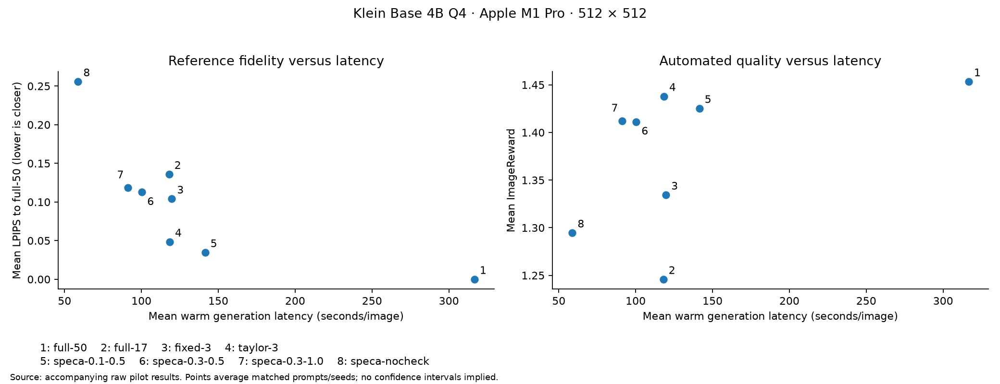
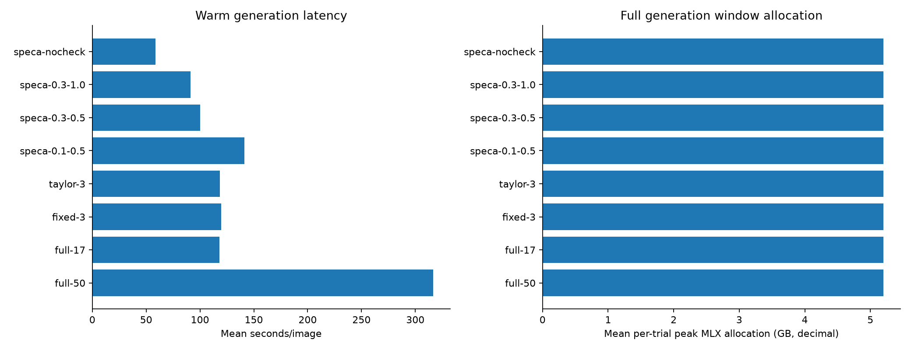
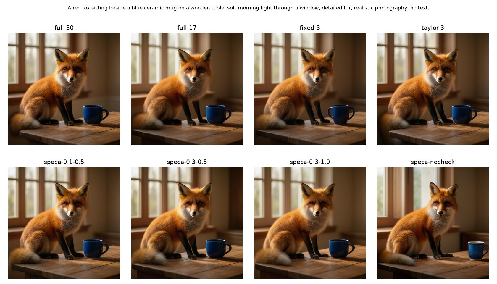
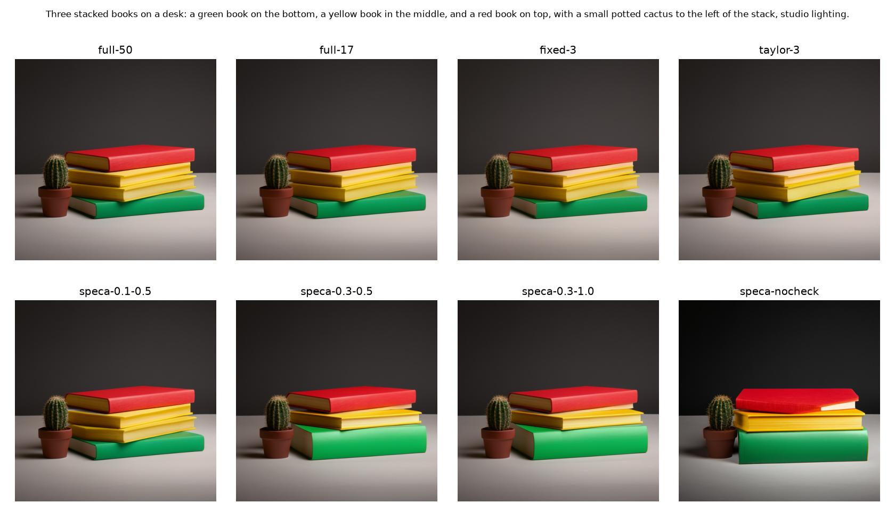
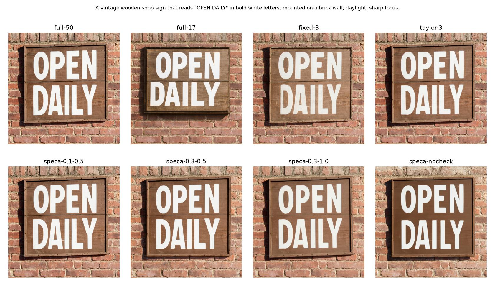
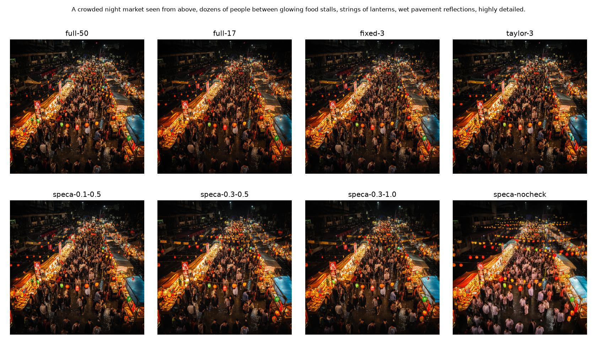
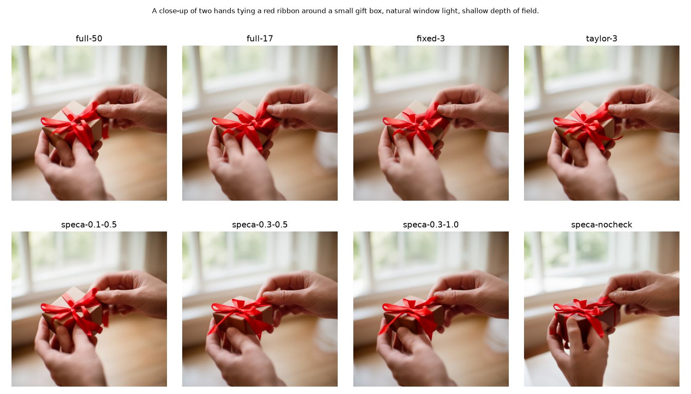
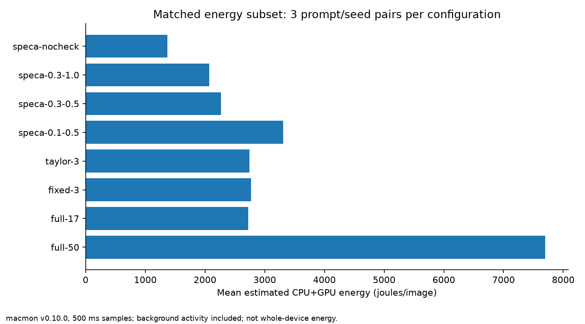

# Klein Base 4B feature-reuse ablation pilot

This report records one local pilot, not a final quality or energy-efficiency claim.

Read [findings and next steps](findings.md) for interpretation. Independent calculation checks are in [validation.json](validation.json).

## Setup

Hardware: Apple M1 Pro; macOS 27.0.1. Model: mflux-community/flux-2-klein-base-4b-mflux-q4 at `f69aa0b43285d0db24695ba68faabbdb1a0ad016`. MFLUX 0.24.0, MLX 0.32.4; FP16 transformer compute, 512 × 512, guidance 3.5, scheduler `flow_match_euler_discrete`.

Coverage: 40 images, 5 prompts, seeds [42], 1 repeat per prompt/seed/config. Configurations rotate order across prompts. All thresholds were specified before inspecting results; these prompts remain a development set, not a held-out generalization test.

Full-50 is the reference. Full-17 reduces sampling steps. Fixed-3 and Taylor-3 each evaluate 17 full steps while retaining 50 scheduler updates. The two threshold settings compare stricter versus looser verification. Speca-0.3-1.0 removes threshold decay; speca-nocheck removes verification while retaining warmup and the reuse cap.

Taylor-3 uses first-order linear extrapolation. The SpeCa-named configurations are Alan's simplified final-block verification heuristic, not validated reproductions of the published implementations. In this policy the first predicted step after a full computation is unchecked, with subsequent predictions checked subject to the configured minimum. These are approximate methods without a lossless guarantee.

## Measurements

| Configuration | Images | Total s | Speedup | Full steps | Checks | Rejections | Peak MLX GB | Cache MB | LPIPS ↓ | SSIM ↑ | CLIP ↑ | ImageReward ↑ | CPU+GPU J/image | Energy n |
| --- | ---: | ---: | ---: | ---: | ---: | ---: | ---: | ---: | ---: | ---: | ---: | ---: | ---: | ---: |
| full-50 | 5 | 316.596 | 1.000 | 50.000 | 0.000 | 0.000 | 5.200 | 0.000 | 0.000 | 1.000 | 36.451 | 1.453 | 7699.839 | 3 |
| full-17 | 5 | 117.964 | 2.684 | 17.000 | 0.000 | 0.000 | 5.200 | 0.000 | 0.136 | 0.835 | 36.299 | 1.246 | 2722.702 | 3 |
| fixed-3 | 5 | 119.697 | 2.645 | 17.000 | 0.000 | 0.000 | 5.200 | 37.749 | 0.104 | 0.877 | 36.455 | 1.334 | 2770.150 | 3 |
| taylor-3 | 5 | 118.350 | 2.675 | 17.000 | 0.000 | 0.000 | 5.200 | 75.497 | 0.048 | 0.936 | 36.294 | 1.438 | 2746.709 | 3 |
| speca-0.1-0.5 | 5 | 141.399 | 2.239 | 19.600 | 29.800 | 16.600 | 5.200 | 75.497 | 0.035 | 0.953 | 36.407 | 1.425 | 3307.888 | 3 |
| speca-0.3-0.5 | 5 | 100.316 | 3.156 | 13.000 | 36.600 | 10.000 | 5.200 | 75.497 | 0.113 | 0.863 | 36.007 | 1.411 | 2266.007 | 3 |
| speca-0.3-1.0 | 5 | 91.119 | 3.475 | 11.400 | 37.800 | 8.000 | 5.200 | 75.497 | 0.118 | 0.848 | 35.870 | 1.412 | 2072.832 | 3 |
| speca-nocheck | 5 | 58.741 | 5.390 | 8.000 | 0.000 | 0.000 | 5.200 | 75.497 | 0.256 | 0.705 | 35.527 | 1.295 | 1366.826 | 3 |





Latency and quality values are arithmetic means over all five prompt/seed pairs. Energy means use only the common covered subset, whose size is listed in Energy n. Speedup is the ratio of mean full-50 time to mean configuration time. Individual results and latency ranges are in results.csv and summary.json.

## Scope and limitations

Total latency covers prompt encoding, denoising, and decoding with resident weights and GPU synchronization. It excludes model loading, PNG writing, and offline scoring. The runner warms the full, forecast, and verification paths. MLX peak memory covers the generation window and includes resident weights; it is not total process footprint or whole-device memory. Persistent prompt-independent weights stay loaded across trials.

Energy is estimated from macmon v0.10.0 CPU+GPU telemetry on the common subset of 3 prompt/seed pairs with complete coverage for every configuration. Earlier images without telemetry are excluded from ALL energy averages. Samples are 500 ms interval averages, positioned approximately at interval midpoints and integrated with linear interpolation. Gaps over two seconds are rejected. These are system component estimates including background activity, not process-isolated, wall-socket, or whole-device energy. No idle subtraction or external-meter calibration was performed. The manifest's initial powermetrics-unavailable status predates this alternative collector; scoring.json records the actual energy scope.

GenEval and human preference are unmeasured. CLIP is a broad alignment proxy and ImageReward, if available, is a learned preference proxy, not a human judgment or a compositional correctness guarantee.

LPIPS/SSIM/PSNR compare each output with the matching full-50 image. Different but valid images can have poor similarity; higher similarity does not prove higher quality. The full-50 reference can itself contain defects. Identical-image PSNR is represented by null with an explicit identity flag. No FID is computed from this small sample.

One seed and one repeat cannot establish cross-seed robustness or isolate thermal/run-order noise. There are no confidence intervals or p95 claims. This is an exploratory ablation, with no predeclared numerical noninferiority threshold. Do not describe approximate feature prediction as lossless speculation.

## Reproduction

```sh
.venv/bin/python scripts/evaluate-klein.py --out outputs/evaluation
.venv-quality/bin/python scripts/score-evaluation.py --out outputs/evaluation --image-reward --power-samples outputs/evaluation/power.json
.venv/bin/python scripts/report-evaluation.py --out outputs/evaluation
```

Environment locks: requirements-mac.txt, requirements-eval.txt, requirements-quality.txt. Raw measurements, scoring metadata, the generation manifest, and all pilot outputs accompany this report. Generation and scoring run separately. Hardware telemetry also includes system RAM/swap usage and GPU temperature for diagnosing environmental interference.

## Visual inspection

### Prompt 0

A red fox sitting beside a blue ceramic mug on a wooden table, soft morning light through a window, detailed fur, realistic photography, no text.



### Prompt 1

Three stacked books on a desk: a green book on the bottom, a yellow book in the middle, and a red book on top, with a small potted cactus to the left of the stack, studio lighting.



### Prompt 2

A vintage wooden shop sign that reads "OPEN DAILY" in bold white letters, mounted on a brick wall, daylight, sharp focus.



### Prompt 3

A crowded night market seen from above, dozens of people between glowing food stalls, strings of lanterns, wet pavement reflections, highly detailed.



### Prompt 4

A close-up of two hands tying a red ribbon around a small gift box, natural window light, shallow depth of field.



## Estimated energy



Collector: [macmon](https://github.com/vladkens/macmon). Power uses CPU+GPU watts only. See power.json for samples, timestamps, temperatures, and RAM/swap context.

During the generation-covered portion of recorded telemetry, GPU temperature ranged from 66.5 to 86.3 °C. System-wide swap in use ranged from 19.0 to 22.2 GB. Existing swap is not attributable to the model. This was an active desktop environment, not an isolated machine; background activity, memory pressure, and thermal drift limit causal interpretation of small differences.

## References

- [TaylorSeer](https://openaccess.thecvf.com/content/ICCV2025/papers/Liu_From_Reusing_to_Forecasting_Accelerating_Diffusion_Models_with_TaylorSeers_ICCV_2025_paper.pdf)
- [SpeCa](https://arxiv.org/abs/2509.11628)
- [SVDQuant](https://arxiv.org/abs/2411.05007)
- [LPIPS](https://arxiv.org/abs/1801.03924)
- [ImageReward](https://arxiv.org/abs/2304.05977)
- [GenEval](https://arxiv.org/abs/2310.11513)
- [ML.ENERGY](https://arxiv.org/abs/2505.06371)
